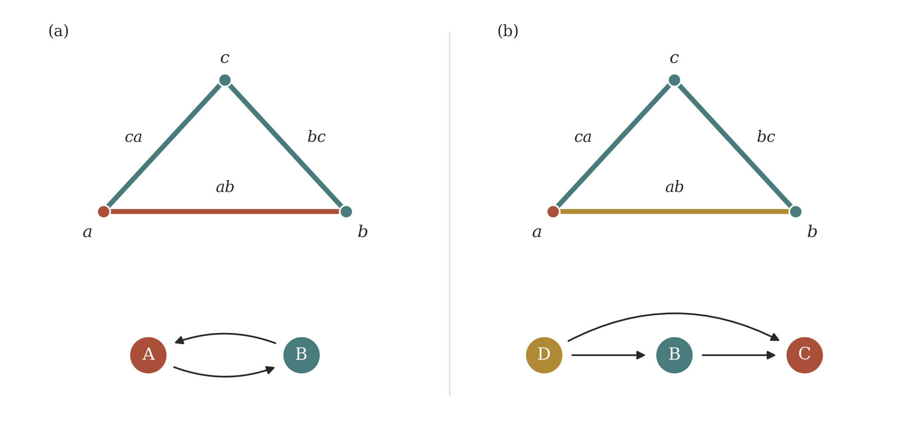

# MVFBarcode

A C++20 tool and header-only library implementing the matrix-update algorithm for Conley–Morse persistence barcodes. It accepts zigzags of multivector fields or block partitions and returns interval endpoints on the supplied fields, expressing the Conley-morse persistence barcode.

## Input, output and usage

### Input format

Each `.smp` file lists the complete complex and one multivector field:

```text
# simplices
0:0
1:1
2:0,1
# multivectors
10:0,2
20:1
```

Before `# multivectors`, records give a simplex ID and its vertex labels. IDs run consecutively from zero, records follow ID order, and every nonempty face is included. After the marker, records give a multivector label and its simplex IDs. Labels are distinct nonnegative integers; omitted simplices form singleton multivectors. Whitespace and `#` comments are allowed.

All files must describe the same complex with the same simplex IDs. Multivectors must be locally closed: if they contain two comparable simplices, they contain every simplex between them in the face order. Consecutive fields must be refinement-comparable, meaning that every multivector of one field is contained in a multivector of the other. Identical fields are allowed. Invalid inputs are rejected.

An optional order file lists every simplex ID exactly once, separated by whitespace. Faces must precede cofaces, and each initial coalesced block must be consecutive. This order will be used when creating a a block-boundary matrix for the initial complex and multivector field.

### Output format

Standard output contains one JSON object. The bundled edge example produces:

```json
{"schema":"mvf_barcodes_v1","barcodes":[{"dimension":0,"birth":0,"death":null},{"dimension":0,"birth":1,"death":2},{"dimension":1,"birth":1,"death":2}]}
```

Indices refer to the original supplied fields, starting at zero. A finite interval is present when `birth <= i < death`; `null` means it survives at the final field. Repeated entries give multiplicity. Unchanged coalesced partitions retain their input indices. Results are sorted by dimension, birth and death.

In the edge example, the first field puts the whole edge complex in one block, the second separates the edge from the block containing its two vertices, and the third rejoins them. One degree-zero interval persists throughout; an additional degree-zero interval and a degree-one interval have support `[1,2)`. The latter records the homology of the edge relative to its endpoints.

### Build and run

A C++20 compiler and Make are sufficient:

```sh
make
./build/cmvf_barcodes examples/small_endpoint_quotient/frame_*.smp > barcode.json
```

This runs the edge example described above. Pass files in the desired sequence. An initial order file is optional; `--help` prints usage.

Supply already acyclic block partitions directly, as in the edge example, or supply multivector fields with cycles between their multivectors:

```sh
./build/cmvf_barcodes field_0000.smp field_0001.smp field_0002.smp > barcode.json
```

Consecutive fields must be related by refinement in either direction. The program constructs their finest block partitions automatically; already acyclic partitions are unchanged. It does not construct connections between incomparable fields.

To provide an initial simplex order instead of using the default:

```sh
./build/cmvf_barcodes --order initial_order.txt field_0000.smp field_0001.smp > barcode.json
```

### Library use

The same computation can be called directly through `mvf_module/mvf_module.hpp`:

```cpp
#include "mvf_module/mvf_module.hpp"

int main() {
    cmvf::barcode_engine engine(cmvf::read_smp("field_0000.smp"));
    engine.advance(cmvf::read_smp("field_0001.smp"));
    const auto bars = engine.barcodes();
}
```

Each interval has `dimension`, `birth` and `death` members. In the C++ interface, a negative `death` denotes survival at the final supplied field. Compile with C++20 and the repository root on the include path.

### Paper examples

Extract the single data archive and run the Torus Chain filtration:

```sh
tar -xJf paper_data.tar.xz
./build/cmvf_barcodes paper_data/torus_chain/frame_*.smp > barcode.json
```

Folders `complex_01` through `complex_09` correspond to Complexes 1–9 in the paper. Each contains `fixed_order`, `fine_reordered` and `coarse_reordered`, with 33 numbered fields per scheme. `torus_chain` contains the 33 fields used for the Torus Chain figure. Files are used in increasing filename order.

The benchmark folders retain the initial orders used in the paper. For example:

```sh
./build/cmvf_barcodes --order paper_data/complex_01/fixed_order/initial_order.txt \
  paper_data/complex_01/fixed_order/frame_*.smp > barcode.json
```

Omit `--order` to use the default rule described below. The long simplexwise inputs are omitted: on any of these complexes, start with all `n` simplices in one block, split off IDs `n-1, n-2, ..., 1`, then undo the splits in reverse order. This gives `2n-1` supplied fields. The paper uses the initial order `0, 1, ..., n-1`, which is dimension-ordered in these data.

## Algorithm

After checking the input conditions above, the program coalesces the fields, initializes a matrix decomposition, and updates it along the zigzag. The output retains interval endpoints at the supplied fields.

### Coalescing multivectors

An arrow between multivectors records a simplex in the first having a codimension-one face in the second. Merging each strongly connected component of this graph gives the finest block partition. Refinement is preserved, so the resulting block partitions form a zigzag in the same directions.



The figure shows an unfilled triangle, with colors identifying multivectors. In (a), `A = {a, ab}` and `B = {b, c, bc, ca}` form a directed cycle: `ab -> b` gives `A -> B`, and `ca -> a` gives `B -> A`. They therefore coalesce into one block.

In (b), split `A` into `C = {a}` and `D = {ab}`, leaving `B` unchanged. The graph is now acyclic, so there are three blocks. Thus one multivector split can require several binary block splits.

### Initial order and reduction

Unless an initial order is supplied, coalesced blocks follow a topological order with faces before cofaces. Whenever several blocks are available, the block containing the smallest simplex ID is chosen. Within each block, simplices are ordered by dimension, then ID.

The program stores the boundary matrix `D` and its decomposition `R = D U` in packed 64-bit columns. Starting from `R = D` and `U = I`, it performs an initial block reduction. Column additions are XOR operations, applied to corresponding columns of `R` and `U` together.

### Updates and interval tracking

Larger refinements and coarsenings are factored into binary block splits or merges, which are then expanded into elementary matrix updates. These operations maintain a block-reduced `R` and a uniform `U`. Subsequent updates use the current matrix order: contiguous cuts and joins preserve it; general splits or nonadjacent merges may require reordering.

The update rules track the births and deaths of features carried by non-homogeneous, non-targeted columns. All updates within one supplied transition use its destination field index. Intervals created and destroyed entirely within that transition have equal endpoints and are discarded, leaving the barcode restricted to the supplied fields.

## Source and citation

`cmvf_barcodes.cpp` handles input and output. The implementation is in `mvf_module/`: `bit_matrix.hpp` contains packed binary matrices, `partitioned_complex.hpp` handles simplicial input and multivector processing, and `barcodes.hpp` implements matrix updates and interval tracking. `mvf_module.hpp` includes these headers for library use.

This project was developed by the [Computational Geometry and Topological Data Analysis (CGTDA) research group](https://www.cs.purdue.edu/homes/tamaldey/CGTDAwebsite/) at Purdue University, with Andrew Haas as the primary software developer. The group is led by [Prof. Tamal K. Dey](https://www.cs.purdue.edu/homes/tamaldey/). See `LICENSE` for attribution and redistribution terms.

The algorithm is described in [Computing Conley-Morse Persistence Barcode Efficiently by Updating Matrix Decompositions](https://arxiv.org/abs/2608.06507) by Tamal K. Dey, Andrew Haas and Michał Lipiński:

```bibtex
@misc{dey2026computing,
  title={Computing Conley-Morse Persistence Barcode Efficiently by Updating Matrix Decompositions},
  author={Tamal K. Dey and Andrew Haas and Michał Lipiński},
  year={2026},
  eprint={2608.06507},
  archivePrefix={arXiv},
  primaryClass={math.AT},
  url={https://arxiv.org/abs/2608.06507}
}
```
